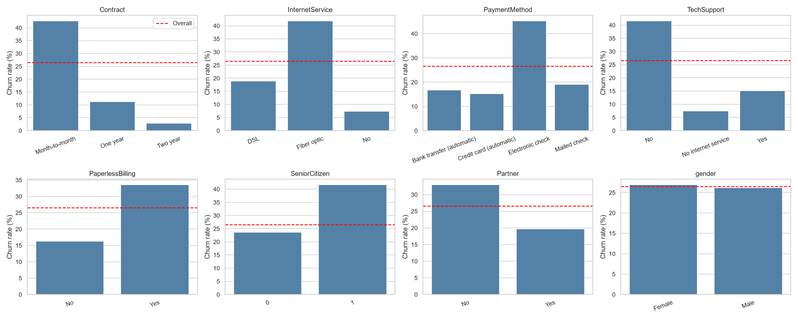
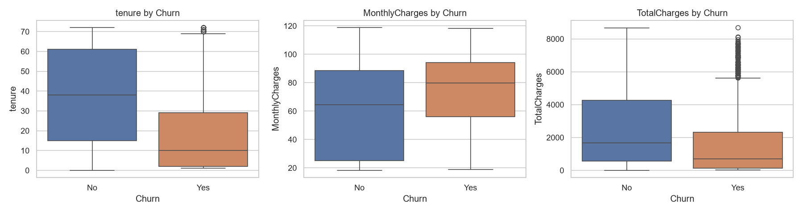
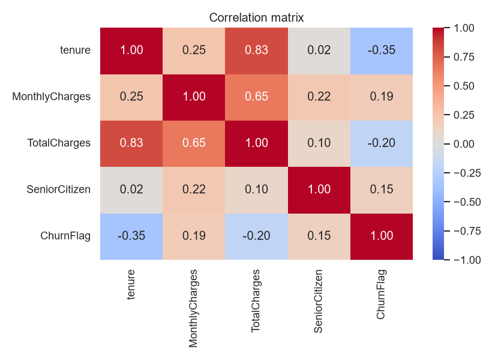

# ML Mastery Lab

A hands-on, beginner-to-practical Machine Learning repository. Every topic has a **study note** (concept) and a **Jupyter notebook** (implementation).

## Objectives
- Learn the complete supervised learning workflow by building a real project.
- Understand every step of the code, not just run it.
- Build a portfolio of ML work, module by module.

## Module 1: Supervised Learning
**Project: Customer Churn Prediction** (binary classification), plus a separate regression exercise.

### Dataset
- **Churn:** IBM Telco Customer Churn, 7,043 customers, 21 columns, target `Churn` (Yes/No).
  Source: https://github.com/IBM/telco-customer-churn-on-icp4d
- **Regression:** California Housing, loaded from scikit-learn (not stored in this repo).

### Technologies
Python, Jupyter Notebook, NumPy, Pandas, Matplotlib, Seaborn, Scikit-learn, Joblib.

### Workflow
Raw data → cleaning → EDA → train/test split → preprocessing pipeline (impute, encode, scale)
→ train 6 classifiers → cross-validation → tuning → comparison → save best model → predict on new data.

### Algorithms
Classification: Logistic Regression, Decision Tree, Random Forest, KNN, SVM, Naive Bayes.
Regression: Linear, Multiple Linear, Decision Tree, Random Forest.

## Installation
```powershell
python -m venv .venv
.venv\Scripts\Activate.ps1
pip install -r requirements.txt
python -m ipykernel install --user --name ml-mastery-lab
jupyter notebook
```

## How to study each topic
1. Read `notes/NN_topic.md`
2. Open `notebooks/.../NN_topic.ipynb` (kernel: `ml-mastery-lab`)
3. Run the cells and study the output
4. Complete the exercise at the end of the notebook

## Folder structure
```
data/raw/        original data (never edited)
data/processed/  generated by notebooks (git-ignored)
notes/           beginner-friendly concept notes
notebooks/       implementation notebooks
src/             small reusable helpers
models/          saved models
reports/figures/ plots
unsupervised/    Module 2 (coming later)
```

## Progress

| # | Topic | Note | Notebook | Status |
|---|---|---|---|---|
| 01 | Data understanding | [note](notes/01_data_understanding.md) | [notebook](notebooks/01_supervised_churn/01_data_understanding.ipynb) | Done |
| 02 | Data cleaning | [note](notes/02_data_cleaning.md) | [notebook](notebooks/01_supervised_churn/02_data_cleaning.ipynb) | Done |
| 03 | Exploratory data analysis | [note](notes/03_eda.md) | [notebook](notebooks/01_supervised_churn/03_eda.ipynb) | Done |
| 04 | Outlier detection and handling | [note](notes/04_outliers.md) | [notebook](notebooks/01_supervised_churn/04_outliers.ipynb) | Done |
| 05-18 | Split, encoding, scaling, pipelines, 6 classifiers, tuning, comparison, saving | | | Planned |
| R1-R2 | Regression exercises | | | Planned |

## Key findings so far
- 7,043 customers, about 26.5% churned (class imbalance, so accuracy alone is misleading).
- `TotalCharges` had 11 hidden blanks (new customers, `tenure = 0`), fixed with a rule-based fill of 0.
- Churn is strongly linked to short tenure, month-to-month contracts (43% churn vs 3% on two-year), fiber optic internet and electronic-check payment.
- `gender` has almost no effect. `tenure` and `TotalCharges` overlap strongly (correlation 0.83).
- No outliers were found in the numeric features.

## Visualizations




## Results and model comparison
_To be added after the models are trained._

## Key learning outcomes
_To be added as each stage is completed._

## Roadmap
- [x] Module 1: Supervised Learning (in progress)
- [ ] Module 2: Unsupervised Learning
- [ ] Module 3: Advanced Machine Learning
- [ ] Module 4: Practical ML Deployment
